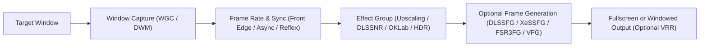

# Magpie Experimental

### Real-time Windows Window Scaling, AI Enhancement & Frame Generation

**Super Resolution · DLSSNR · OKLab Color Grading · RTX Video · Frame Generation · Frame Sync**

 

 

[**⬇ Download v0.6.12**](https://github.com/SAOG0721/Magpie/releases/tag/v0.6.12-experimental)
&nbsp;·&nbsp;
[**🇨🇳 简体中文**](./README_ZH.md)
&nbsp;·&nbsp;
[**📖 Built-in Effects**](docs/Built-in%20effects.md#current-branch-setup)
&nbsp;·&nbsp;
[**⚡ Frame Sync Guide**](docs/FRAME_SYNC_GUIDE.md)
&nbsp;·&nbsp;
[**🐛 Report an Issue**](https://github.com/SAOG0721/Magpie/issues)

<!-- Optional visual showcase: replace with a screenshot of Magpie Experimental (main UI, live parameter overlay, or split comparison)

  

-->

---

**Magpie Experimental** is an unofficial fork of [Blinue/Magpie](https://github.com/Blinue/Magpie) for Windows. Built on Magpie's window-capture and effect pipeline, it brings experimental **DLSS, XeSS, FSR, RTX Video, DLSSNR, OKLab color grading, frame generation, and frame-pacing controls** to games, video players, and other windowed apps—without requiring native integration from the source application.

> [!NOTE]
> This is **not** an official Magpie release. Please report experimental-fork issues and discussions in [this repository](https://github.com/SAOG0721/Magpie/issues).

## Latest Update · v0.6.12

- **OKLab Image Adjustment**: New same-size color grading effect with exposure, curves, color wheels, 8-color mixer, `.cube` LUT import/export, live eyedropper, and A/B split comparison.
- **DLSSNR Models & Performance**: Added model presets (**Automatic / HT / CC Small FP8**), **Adaptive / Manual** input resolution scaling, **Every Frame / Alternating Frames** (2/3/4) with AMDOF/NVOF reprojection, plus Midtone Strength and global Chroma Protection.
- **Live Overlay & Profiler**: Adaptive grouped layout with vertical scrolling, **Ctrl + Mouse Wheel** overlay zoom (50%–200%), remembered profiler collapse states, and new-content FPS accounting.
- **Capture & VRR**: Improved WGC capture recovery and cursor handling, plus experimental gap-fill resubmission on supported WGC + DLSSNR + Front Edge + VRR paths.

👉 [Read the full v0.6.12 release notes (EN / 中文)](docs/RELEASE_NOTES_v0.6.12-experimental.md)

## Main Features

### Effects & Hardware Overview

| Category | Effects / Capabilities | Purpose | Hardware Notes |
| --- | --- | --- | --- |
| Spatial upscaling & sharpening | Lanczos, FSR, CAS, and MagpieFX shaders | Enlarge window content and adjust clarity and detail | Any DirectX 11 GPU |
| Color grading | **OKLab Image Adjustment** (curves, wheels, 8-color mixer, `.cube` LUT, local contrast, dehaze, masks) | Same-resolution color grading with live editing and presets | Any DirectX 11 GPU |
| Temporal super resolution *(experimental)* | DLSS SR, FSR 2/3/4, XeSS SR | Reconstruct higher-resolution frames using captured images and estimated motion | Depends on backend (DLSS requires NVIDIA RTX) |
| AI image enhancement | **DLSSNR** (model presets, adaptive/manual scale, every/alternating frames, multi-pass) | AI tone, structure, shadow, reflection, glow, and residual/detail control | NVIDIA RTX (RTX 20/30/40 bundled; RTX 50 DLL option available) |
| Video enhancement | **RTX Video** (VSR, Denoise, Deblur, TrueHDR) | Video super resolution, denoising, and SDR-to-HDR conversion | NVIDIA RTX (TrueHDR requires Windows HDR) |
| Frame generation | **DLSSFG, XeSSFG, FSR3FG, NVIDIA VFG** | Generate intermediate frames between real frames for smoother motion | Depends on backend & GPU (VFG requires Ada/Blackwell) |

Availability depends on GPU architecture, driver version, bundled runtimes, and effect combinations. See the [Built-in Effects Guide](docs/Built-in%20effects.md#current-branch-setup) and each build's [Release Notes](https://github.com/SAOG0721/Magpie/releases) for detailed requirements.

### Workflow, Live Tuning & Frame Sync

- **Effect Groups**: Chain multiple effects in order with per-app profiles, saved parameters, and scaling settings.
- **Live Parameter Overlay**: Adjust parameters while viewing the output with automatic saving, clear **Live / Restart** badges, double-click slider reset, and **Ctrl + Mouse Wheel** zoom (50%–200%).
- **Comparison & Performance Profiler**: Toggle original/processed comparison, take screenshots, and inspect per-pass GPU timings alongside separate real-content and generated frame rates.
- **Frame Rate & Refresh**: Unified **Simple / Advanced** pacing controls supporting **Front Edge, Async, and NVIDIA Reflex**, idle static-picture redraw, cursor refresh policies, optional **RTSS** frame-cap integration, and experimental **VRR**. See the [Frame Sync Guide](docs/FRAME_SYNC_GUIDE.md).

## Processing Pipeline

*Note: Frame generation runs after image processing (except admitted post-stage entries after `TrueHDR` in VFX HDR chains).*

## Download, Install & Upgrade

> [!IMPORTANT]
> Download the release package **`Magpie-Experimental-x64.zip`** from [GitHub Releases](https://github.com/SAOG0721/Magpie/releases). GitHub's automatically generated `Source code` archives are for development and cannot be run directly.

1. Open [GitHub Releases](https://github.com/SAOG0721/Magpie/releases), check the notes for the latest build, and download **`Magpie-Experimental-x64.zip`**.
2. Fully exit any running Magpie instance from the system tray and extract the complete package into a **new folder**.
3. Run `Magpie.exe`, choose an effect group and target window, and trigger scaling using the shortcut shown on Home.

### Release Assets

| Asset | Purpose |
| --- | --- |
| `Magpie-Experimental-x64.zip` | Complete standalone package (bundles community compatibility DLSSNR 310.9.16 for RTX 20/30/40). |
| `DLSSNR-DLL-Options.zip` | Optional `nvngx_dlssnr.dll` choices (NVIDIA original for RTX 50 and community build for RTX 20/30/40). Exit Magpie and back up the existing DLL before replacing. |
| `NGX_OTA_Switch.bat` | Optional NVIDIA NGX OTA update toggle (requires Administrator privileges). Not needed for normal installation. |

**Upgrading & rollback:** Back up any settings and screenshots you want to keep outside the program directory before upgrading, and keep your previous folder if you may need to roll back.

## Usage Notes & Compatibility

- **System requirements**: Windows x64 and a DirectX 11-capable GPU; individual AI and frame-generation backends have higher GPU/driver requirements.
- **Not native in-game integration**: Magpie processes captured window images without access to a game engine's native motion vectors, depth buffer, exposure, or separated UI. Estimated optical flow assists some effects, but results are not equivalent to native in-game DLSS/FSR/XeSS.
- **UI & temporal artifacts**: Image processing can affect text and HUD elements along with the scene, and temporal effects may introduce ghosting or trails. Use **Comparison** to evaluate each effect on your content.
- **Frame generation limits**: Use only one frame-generation effect per group and avoid stacking it with other frame generators. Generated FPS is not the game's real rendering rate and does not proportionally reduce input latency.

## Reporting Issues

Start with the suggestions in Home's **recent-issue card** or open the log directory. When filing an [issue](https://github.com/SAOG0721/Magpie/issues), please include:

- Application version, GPU model, and driver version
- Effect group and key parameter / refresh settings
- Input and output resolution
- Reproduction steps and relevant log files

For general Magpie usage questions, see the [upstream Magpie FAQ](https://github.com/Blinue/Magpie/wiki/FAQ).

## Development & Documentation

This repository contains the Magpie application, MagpieFX shaders, and experimental native effect backends. Optional proprietary backends are disabled by default in source builds and require separately supplied SDKs configured in the untracked `src/BuildOptions.props.user` file.

| Document | Description |
| --- | --- |
| [Built-in Effects Guide](docs/Built-in%20effects.md#current-branch-setup) | Frame-generation chains, HDR conversion, and shared settings |
| [Frame Sync Guide](docs/FRAME_SYNC_GUIDE.md) | Pacing modes, cursor refresh, RTSS integration, and VRR |
| [Third-Party & Redistribution](docs/THIRD_PARTY_AND_REDISTRIBUTION.md) | Dependencies, licenses, and build boundaries |
| [Experimental Docs](docs/experimental/README.md) | Feature designs, baselines, and development records |
| [Build & Packaging Script](scripts/Build-Release.ps1) | Release build and packaging automation |
| [MagpieFX Format](<docs/MagpieFX (EN).md>) | Writing custom MagpieFX effects |

## Related Projects & Ecosystem

- **Upstream**: [Blinue/Magpie](https://github.com/Blinue/Magpie) — the official Magpie window-scaling tool that this experimental fork builds upon.
- **Community Ecosystem**: [Veyra (Likely7/Veyra-NRVideo)](https://github.com/Likely7/Veyra-NRVideo) and its community derivatives — dedicated Windows video-player, capture-card, and console/PC streaming enhancement tools exploring similar real-time GPU technologies (DLSSNR, super resolution, HDR, and frame generation) for media and capture workflows.

## Contributions & Acknowledgments

Built on [Blinue/Magpie](https://github.com/Blinue/Magpie) and its contributors' work. Thanks to everyone contributing code, translations, ideas, and testing feedback:

- [HexBen123](https://github.com/HexBen123): Early depth-estimation performance optimization, TensorRT integration guidance, and the [DLSSNR parameter-localization proposal](https://github.com/SAOG0721/Magpie/pull/16).
- [Kristijan1001](https://github.com/Kristijan1001): [Reference implementation for editing effect parameters while scaling](https://github.com/SAOG0721/Magpie/pull/4), which informed the live parameter panel.
- [LCPD15](https://github.com/LCPD15): [1.0× windowed-scaling fix](https://github.com/SAOG0721/Magpie/pull/3) for displaying same-resolution effects at source size.
- [TurnX-alt](https://github.com/TurnX-alt): [Build, UI, and repository consistency improvements](https://github.com/SAOG0721/Magpie/pull/23), including ClangCL build fixes without optional SDKs and consistency checks.
- [konodiodaaaaa1](https://github.com/konodiodaaaaa1): [HDR support and compatibility work](https://github.com/SAOG0721/Magpie/pull/24).
- [Len-huan](https://github.com/Len-huan): DLSSNR weight-preset suggestions and analysis in [issue #73](https://github.com/SAOG0721/Magpie/issues/73).
- [yejincheng420](https://github.com/yejincheng420): Foundational alternating-frame processing idea shared in their [Magpie fork](https://github.com/yejincheng420/Magpie/tree/turing-ampere).

Contributions via Issues and Pull Requests are welcome. See [Contributors](https://github.com/SAOG0721/Magpie/graphs/contributors) for the full contribution history.

## Star History

  <a href="https://gittrend.io/repo/SAOG0721/Magpie">
    <picture>
      <source media="(prefers-color-scheme: dark)" srcset="https://gittrend.io/api/badge/chart/SAOG0721/Magpie.svg?theme=dark" />
      <source media="(prefers-color-scheme: light)" srcset="https://gittrend.io/api/badge/chart/SAOG0721/Magpie.svg" />
      
    </picture>
  </a>

## License

Magpie-derived source code is licensed under [GPLv3](LICENSE). Third-party SDKs, models, and runtimes are governed by their own licenses; see [Third-Party and Redistribution Notes](docs/THIRD_PARTY_AND_REDISTRIBUTION.md).
