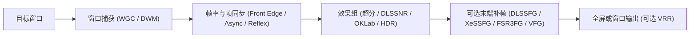

# Magpie Experimental

### 面向 Windows 的实时窗口缩放、AI 画面增强与帧生成工具

**超分辨率 · DLSSNR · OKLab 调色 · RTX Video · 多后端补帧 · 帧同步**

 

 

[**⬇ 下载 v0.6.12**](https://github.com/SAOG0721/Magpie/releases/tag/v0.6.12-experimental)
&nbsp;·&nbsp;
[**🌍 English**](./README.md)
&nbsp;·&nbsp;
[**📖 内置效果说明**](docs/Built-in%20effects.md#current-branch-setup)
&nbsp;·&nbsp;
[**⚡ 帧同步指南**](docs/FRAME_SYNC_GUIDE.md)
&nbsp;·&nbsp;
[**🐛 问题反馈**](https://github.com/SAOG0721/Magpie/issues)

<!-- 可选视觉展示：替换为 Magpie Experimental 的界面截图、实时调参浮窗或对比图后取消注释

  

-->

---

**Magpie Experimental** 是 [Blinue/Magpie](https://github.com/Blinue/Magpie) 的非官方实验分支。它在 Magpie 的窗口捕获与效果管线基础上，为游戏、视频播放器及其他窗口应用带来实验性的 **DLSS、XeSS、FSR、RTX Video、DLSSNR、OKLab 调色、多后端补帧与帧同步控制**——目标应用无需原生集成任何接口。

> [!NOTE]
> 本项目**不代表** Magpie 官方发布。实验分支相关的使用问题与兼容性反馈请提交到[本仓库 Issues](https://github.com/SAOG0721/Magpie/issues)。

## 最新更新 · v0.6.12

- **新增 OKLab Image Adjustment 调色效果器**：保持画面尺寸，支持曝光、曲线、三向色轮、八色混合、`.cube` LUT 导入／导出、实时吸管取色与分屏／A/B 对比。
- **DLSSNR 模型与性能升级**：新增模型预设（**自动 / HT / CC Small FP8**）、**自适应／手动**输入分辨率缩放、**逐帧／隔帧**（2/3/4 帧，支持 AMDOF/NVOF 对齐复用），以及中间调强度与全域色度保护。
- **实时参数面板与性能分析改进**：自适应分组布局与纵向滚动、运行浮窗内 **Ctrl＋滚轮缩放界面（50%–200%）**、记忆分析器折叠状态，无补帧时按新内容统计帧率。
- **捕获与 VRR 优化**：改进 WGC 捕获恢复与光标处理，并在受支持的 `WGC + DLSSNR + Front Edge + VRR`（无补帧）路径支持短暂空档补交。

👉 [查看 v0.6.12 完整更新说明（中／英）](docs/RELEASE_NOTES_v0.6.12-experimental.md)

## 主要功能

### 效果与硬件支持概览

| 类别 | 效果与能力 | 用途 | 硬件要求参考 |
| --- | --- | --- | --- |
| 空间缩放与锐化 | Lanczos、FSR、CAS 及各类 MagpieFX 效果 | 放大窗口内容，调整清晰度与细节表现 | 支持 DirectX 11 的显卡 |
| 专业调色 | **OKLab Image Adjustment**（曲线、色轮、八色混合、`.cube` LUT、局部对比度、去雾、蒙版） | 同分辨率实时调色，支持预设与吸管取色 | 支持 DirectX 11 的显卡 |
| 实验性时序超分 | DLSS SR、FSR 2/3/4、XeSS SR | 基于捕获画面与估算运动信息进行图像重建 | 依后端而定（DLSS 需 NVIDIA RTX） |
| AI 画面增强 | **DLSSNR**（模型预设、自适应／手动缩放、逐帧／隔帧、多层处理） | AI 色调、结构、阴影、反射、辉光与残差细节调节 | NVIDIA RTX（主包自带 20/30/40 兼容版，另提供 50 系原版选项） |
| 视频增强 | **RTX Video**（VSR、降噪、去模糊、TrueHDR） | 视频超分辨率、降噪及 SDR → HDR 转换 | NVIDIA RTX（TrueHDR 需开启 Windows HDR） |
| 帧生成（补帧） | **DLSSFG、XeSSFG、FSR3FG、NVIDIA VFG** | 在真实帧之间生成中间画面，提升视觉流畅度 | 依后端与显卡而定（VFG 需 Ada/Blackwell） |

具体可用性取决于显卡架构、驱动版本、运行组件及效果组合，详见[内置效果使用说明](docs/Built-in%20effects.md#current-branch-setup)与各版本 [Release 说明](https://github.com/SAOG0721/Magpie/releases)。

### 效果组、实时调参与帧同步

- **效果组与配置**：按顺序组合多个效果器，为不同应用保存独立的效果组、参数与缩放设置。
- **运行期实时参数面板**：边看画面边调节并自动保存；清晰标明 **Live（实时）** 或 **Restart（需重新启用）**，支持双击滑条恢复默认与 **Ctrl＋滚轮** 调整浮窗缩放（50%–200%）。
- **对比与性能分析**：工具栏支持原图／处理后对比、截图、各 Pass 耗时监测；开启补帧时可分别查看真实内容帧率与输出帧率。
- **帧率与刷新**：提供**简单／高级**模式，支持 **Front Edge / Async / NVIDIA Reflex** 节奏方式、静态画面重绘、光标刷新策略、可选 **RTSS** 限帧联动及实验性 **VRR**，详见[帧同步指南](docs/FRAME_SYNC_GUIDE.md)。

## 处理管线

*说明：补帧通常在图像处理之后执行（VFX HDR 链中首个 `TrueHDR` 之后的允许后处理条目除外）。*

## 下载、安装与升级

> [!IMPORTANT]
> 请从 [GitHub Releases](https://github.com/SAOG0721/Magpie/releases) 下载主包 **`Magpie-Experimental-x64.zip`**。GitHub 自动生成的 `Source code` 源码压缩包仅用于开发编译，不能直接运行。

1. 前往 [GitHub Releases](https://github.com/SAOG0721/Magpie/releases) 选择最新版本，阅读更新说明并下载 **`Magpie-Experimental-x64.zip`**。
2. 从系统托盘**完全退出**正在运行的 Magpie，将完整压缩包解压到一个**新目录**。
3. 运行其中的 `Magpie.exe`，选择效果组和目标窗口，按主页提示的快捷键启用效果。

### Release 附件说明

| 文件 | 用途 |
| --- | --- |
| `Magpie-Experimental-x64.zip` | 可独立运行的完整主包（默认附带 310.9.16 社区兼容 DLSSNR，供 RTX 20/30/40 系列使用）。 |
| `DLSSNR-DLL-Options.zip` | 可选 `nvngx_dlssnr.dll` 切换包（含 RTX 50 NVIDIA 原版与 RTX 20/30/40 社区兼容版）。替换前请先退出 Magpie 并备份原 DLL。 |
| `NGX_OTA_Switch.bat` | 可选的 NVIDIA NGX OTA 更新开关工具（需管理员权限），常规安装无需运行。 |

**升级与回退：** 升级前请将需要保留的设置和截图备份到程序目录之外，并保留旧版目录以便必要时回退。

## 使用与兼容性说明

- **运行环境**：发布主包面向 Windows x64，最低要求支持 DirectX 11 的显卡；各 AI 效果与补帧后端有更高的显卡和驱动要求。
- **不同于游戏原生集成**：Magpie 基于捕获的完整窗口画面处理，无法获取游戏引擎原生的运动矢量、深度缓冲、曝光及独立 UI 信息。估算光流可辅助部分效果，但不能等同于游戏原生 DLSS／FSR／XeSS。
- **UI 与时序伪影**：画面处理会同时作用于文字与 HUD，时序效果可能产生拖影或闪烁，建议使用工具栏的**对比**功能判断是否适合当前内容。
- **补帧限制**：同一效果组只使用一种帧生成效果，避免与其他补帧系统叠加；生成帧率不等于游戏真实渲染帧率，也不代表输入延迟同比降低。

## 问题反馈

遇到问题时，建议先查看主页**“最近一次问题”**的处理建议，或打开日志目录排查。向 [Issues](https://github.com/SAOG0721/Magpie/issues) 反馈时，请附上：

- 程序版本、显卡型号与驱动版本
- 使用的效果组及关键参数／刷新设置
- 输入与输出分辨率
- 复现步骤与相关日志文件

DLSSNR 异常排查见 [DLSSNR 状态与恢复](docs/DLSSNR-TROUBLESHOOTING.md)，常见报错汇总见[报错排查指南](docs/报错排查指南.md)；通用使用问题也可参考 [FAQ](docs/FAQ.md) 或 [Magpie 上游 FAQ](https://github.com/Blinue/Magpie/wiki/FAQ)。

## 开发与文档

本仓库包含 Magpie 主程序、MagpieFX 着色器及实验性原生效果后端。源码构建默认关闭可选专有后端，相关 SDK 与运行库需另行准备，并在不入库的 `src/BuildOptions.props.user` 中配置本机路径。

| 文档 | 说明 |
| --- | --- |
| [内置效果使用说明](docs/Built-in%20effects.md#current-branch-setup) | 补帧组合、HDR 转换与共用设置 |
| [帧同步使用指南](docs/FRAME_SYNC_GUIDE.md) | 节奏模式、光标刷新、RTSS 联动与 VRR |
| [第三方依赖与再分发说明](docs/THIRD_PARTY_AND_REDISTRIBUTION.md) | 第三方组件、许可证与构建边界 |
| [实验功能设计记录](docs/experimental/README.md) | 功能设计、开发基线与历史记录 |
| [构建与打包脚本](scripts/Build-Release.ps1) | 发布构建与打包自动化脚本 |
| [MagpieFX 效果格式](docs/MagpieFX.md) | 编写自定义 MagpieFX 效果 |

## 相关项目与生态

- **上游项目**：[Blinue/Magpie](https://github.com/Blinue/Magpie) —— 官方 Magpie 窗口缩放工具，本实验分支基于其源码演进。
- **社区生态**：[Veyra（Likely7/Veyra-NRVideo）](https://github.com/Likely7/Veyra-NRVideo) 及其社区衍生项目 —— 面向视频播放、采集卡与主机／PC 串流的实时 GPU 画面增强工具，在同一社区生态中探索 DLSSNR、超分、HDR 与补帧等技术在影音和采集场景的应用。

## 贡献与致谢

本项目建立在 [Blinue/Magpie](https://github.com/Blinue/Magpie) 及其贡献者的工作之上，也感谢所有提交代码、翻译、建议与测试反馈的参与者：

- [HexBen123](https://github.com/HexBen123)：早期深度估算性能优化、TensorRT 集成指导，以及 [DLSSNR 参数本地化提案](https://github.com/SAOG0721/Magpie/pull/16)。
- [Kristijan1001](https://github.com/Kristijan1001)：[缩放期间实时编辑效果参数的参考实现](https://github.com/SAOG0721/Magpie/pull/4)，为本项目实时参数面板提供了设计参考。
- [LCPD15](https://github.com/LCPD15)：[窗口模式 1.0× 倍率修复](https://github.com/SAOG0721/Magpie/pull/3)，支持同分辨率效果按原尺寸显示。
- [TurnX-alt](https://github.com/TurnX-alt)：[构建、界面与仓库一致性改进](https://github.com/SAOG0721/Magpie/pull/23)，包括无 SDK 下的 ClangCL 构建修复与一致性检查套件。
- [konodiodaaaaa1](https://github.com/konodiodaaaaa1)：[HDR 支持与兼容性适配](https://github.com/SAOG0721/Magpie/pull/24)。
- [Len-huan](https://github.com/Len-huan)：在 [issue #73](https://github.com/SAOG0721/Magpie/issues/73) 中提出 DLSSNR 权重预设建议并提供分析。
- [yejincheng420](https://github.com/yejincheng420)：在其 [Magpie 分支](https://github.com/yejincheng420/Magpie/tree/turing-ampere) 中分享隔帧处理的基础思路。

欢迎通过 Issues 和 Pull Requests 参与贡献，完整记录见 [Contributors](https://github.com/SAOG0721/Magpie/graphs/contributors)。

## Star History

  <a href="https://gittrend.io/repo/SAOG0721/Magpie">
    <picture>
      <source media="(prefers-color-scheme: dark)" srcset="https://gittrend.io/api/badge/chart/SAOG0721/Magpie.svg?theme=dark" />
      <source media="(prefers-color-scheme: light)" srcset="https://gittrend.io/api/badge/chart/SAOG0721/Magpie.svg" />
      
    </picture>
  </a>

## 许可

Magpie 派生源码采用 [GPLv3](LICENSE)。第三方 SDK、模型与运行组件适用各自的许可证，详见[第三方组件与再分发说明](docs/THIRD_PARTY_AND_REDISTRIBUTION.md)。
